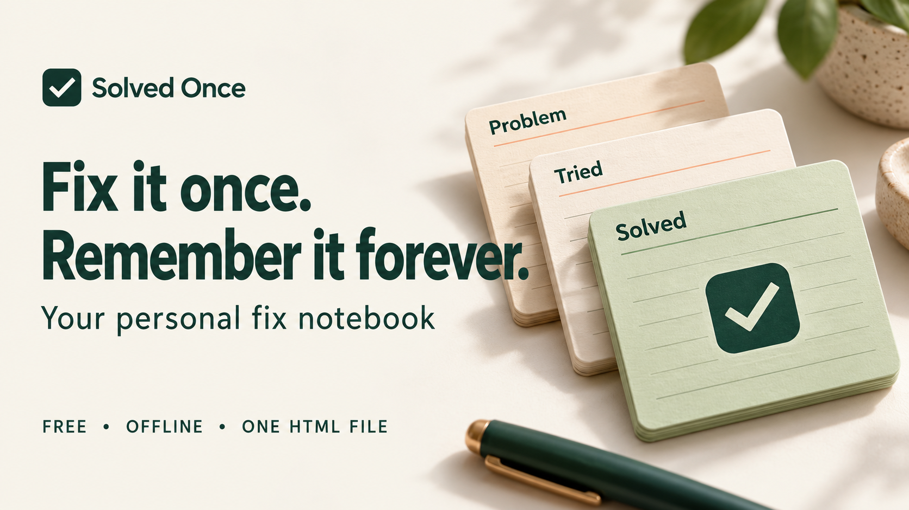

# Solved Once

**Your personal fix notebook. Free, offline, and contained in one HTML file.**

Keep the problem, what you tried, and the solution that worked. Find it the next time the same thing happens.

## Start here

1. Extract this ZIP into a folder on your computer.
2. Open **index.html** in your desktop browser. If it opens in a text editor, use **Open with** and choose your browser.
3. Click **Add your first fix**, or explore the fictional examples.
4. Click **Save fix** when you finish editing.

The app needs no installation, account, internet connection, build process, or extra files. Only `index.html` is needed to run it. The rest of this package helps you share the project.

## What it does

- Search titles, devices, tags, problems, attempts, captions, and solution steps.
- Keep fixes in progress or mark them solved once a working solution is recorded.
- Record failed, partial, and successful attempts.
- Add and reorder numbered steps, then tick through them in Follow steps mode.
- Attach screenshots and photos, add captions, and associate images with individual steps.
- Pin frequently used fixes.
- Copy notes as text, print them, or save a standalone HTML instruction card with images.
- Export the whole notebook as JSON and merge backups without overwriting changed versions.
- Undo deletion immediately from the confirmation message.

## Keep your notes

**Your saved notes are stored in this browser, not inside `index.html`.** Use the same browser, profile, and file location to return to them. Moving or renaming the app, using another browser, private browsing, clearing site data, or browser storage eviction may make those notes unavailable.

Use **Backup & restore → Export backup** regularly. The JSON file contains your notes and images. To move to another computer, copy `index.html` and your JSON backup, open the app there, and restore the backup.

If browser storage cannot open, a visible warning explains that the app is running for the current session only. Export a backup before closing that tab.

A **Save card** HTML file is a readable, printable copy of one fix. Use JSON backups to restore editable notes. Downloads are only used for the backups and cards you explicitly export; attaching a screenshot processes a local copy and does not modify the original image.

## Privacy, compatibility, and limits

The app makes no network requests. It has no cloud sync, analytics, account, or external font/script dependency. Your notes and backups are not password encrypted. The fictional example notebook is separate from your own records.

Modern desktop Chrome, Edge, Firefox, and Safari are intended targets. Local-file storage and download behavior varies by browser. JavaScript must be enabled. Print to PDF uses your browser/operating system's print options. The layout adapts to narrow screens, but desktop use is the primary workflow.

Limits: 500 fixes per notebook, 30 attempts and 30 steps per fix, 6 images per fix, and a 50 MB notebook/backup. Each source image may be up to 15 MB and 40 megapixels. Images are resized to at most 1,600 px on the longest side and flattened onto white to keep backups compact. PNG, JPG, and WebP are supported. Follow-mode checkmarks reset when you leave the fix.

## Files in this package

| File | Purpose |
| --- | --- |
| `index.html` | The complete app and editable source |
| `README.md` | Quick start and upload guide |
| `Listing-Copy.txt` | Product description, short copy, FAQs, and social captions |
| `LICENSE.txt` | MIT license |
| `Images/Banner-Horizontal.png` | Horizontal cover, 1672 × 941 |
| `Images/Banner-Vertical.png` | Vertical promotion, 940 × 1672 |
| `Images/Banner-Square.png` | Square promotion, 1254 × 1254 |
| `Images/Product-Image.png` | Product explainer, 1254 × 1254 |
| `Images/Image-Prompts.txt` | Prompts used for the generated artwork |

The promotional images are conceptual illustrations, not screenshots of the app.

## Upload guide

### Gumroad

1. Create a digital product using the title and description in `Listing-Copy.txt`.
2. Attach `SolvedOnce-Complete-Package.zip` as the downloadable content.
3. Use the horizontal image for the cover, the square image for the thumbnail, and the explainer for an additional product image.
4. Set the amount to **$0**, with a suggested amount of **$0** if shown. Keep every feature in the same free download.
5. Check the listing preview and free download flow before publishing.

Gumroad's documented free-download setup uses **$0+ / pay what you want** for a product without priced versions. Customers can enter 0; the platform may also allow an optional amount. Use “Enter 0 to download free” in the listing. For distribution with no price entry, also provide the ZIP on GitHub.

Source checked 17 October 2026: [Gumroad free product pricing](https://gumroad.com/help/article/133-pay-what-you-want-pricing).

### GitHub

1. Create a repository named `solved-once`.
2. Use **Add file → Upload files** to upload the contents of this `SolvedOnce` folder into the repository root. Keep the `Images` folder together with its files.
3. The included README serves as the project page. Use the repository description and topics in `Listing-Copy.txt`.
4. Attach the complete ZIP to a release named **v1.0.0** for an easy download.

No package manager or build command is required. A static host can serve `index.html` as-is. Hosted and downloaded copies use separate browser storage; move notes between them with a JSON backup. The downloaded copy is the intended offline version.

Source checked 17 October 2026: [GitHub file upload guide](https://docs.github.com/en/repositories/working-with-files/managing-files/adding-a-file-to-a-repository).

### Other platforms

Use the complete ZIP as the free download, copy the description from `Listing-Copy.txt`, and choose the banner that fits the platform. Keep the price at zero and include the browser-storage/backup note from the listing.

## Release checks

Version 1.0.0 · 17 October 2026.

14 automated checks passed: backup round-trips with image bytes and step associations; merge conflicts; invalid and unsafe imports; record limits; search; safe standalone cards; session storage; failed browser transactions; self-contained packaging; and five DOM-simulated app workflows covering editing, images, exports, restore, discard, delete/undo, and stale edits.

**Live browser interaction and visual layout testing were unavailable in the build environment.** These checks do not establish cross-browser compatibility. Before a public launch, open the file in your chosen browser, save a small fix with a screenshot, reload it, then export and restore a backup in another profile.

## Editing the app

All styles, icons, and JavaScript are inline in `index.html`. Open it in a text editor to change the appearance or behavior. The app has no third-party JavaScript dependencies. Keep `solved-once-v1` and the version-1 backup schema compatible if you want existing notebooks to continue working.

## License

MIT - see `LICENSE.txt`. This release is distributed free with all features included.
